<p align="center">
  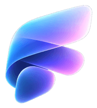
</p>

# FOCAL

Focal is a high-performance, minimalist mobile productivity application engineered with React Native, Expo SDK 57, and Reanimated. Built with Swiss graphic design and Apple Human Interface Guidelines in mind, it provides an uncluttered environment for deep cognitive focus, custom session intervals, procedural audio tonalities, authentic natural soundscapes, and physical haptic resonance.

---

### Tech Stack & Core Dependencies

<p align="left">
  
  
  
  
  
  
  
  
</p>

---

### Interface & Flow Showcase

#### 1. Onboarding & 3D Spatial Gyroscope Architecture

<table>
  <tr>
    <td align="center" width="33.3%">
      <b>01 // Sundial Desk Hero</b><br/><br/>
      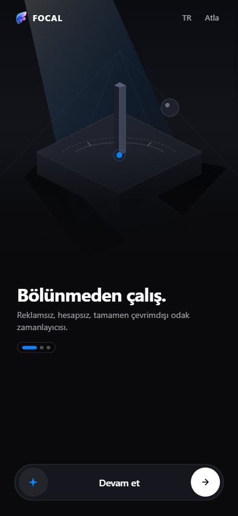
      <p align="left"><sub>Full-bleed 3D isometric chronometer artwork with native perspective rendering, bilingual localization toggle, and distraction-free value proposition.</sub></p>
    </td>
    <td align="center" width="33.3%">
      <b>02 // Acoustic Waves & Permissions</b><br/><br/>
      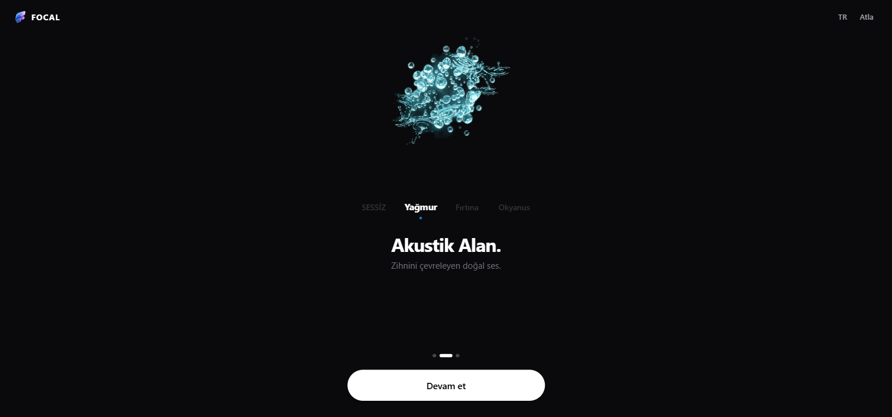
      <p align="left"><sub>Orbital gyroscope visualizer paired with transparent native notification permission request and interruptible skip handling.</sub></p>
    </td>
    <td align="center" width="33.3%">
      <b>03 // Flow State Toggles & Setup</b><br/><br/>
      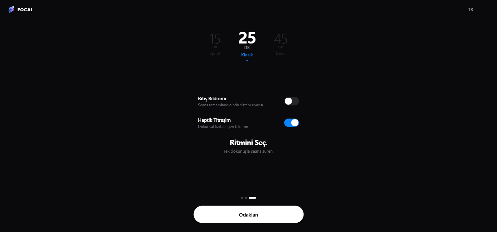
      <p align="left"><sub>Resonance curves with custom SVG switch toggles for haptics, audio cues, and end notifications before entering the primary timer.</sub></p>
    </td>
  </tr>
</table>

#### 2. Minimalist Chronometer & Focus Modes

<table>
  <tr>
    <td align="center" width="25%">
      <b>04 // Obsidian Dark Mode</b><br/><br/>
      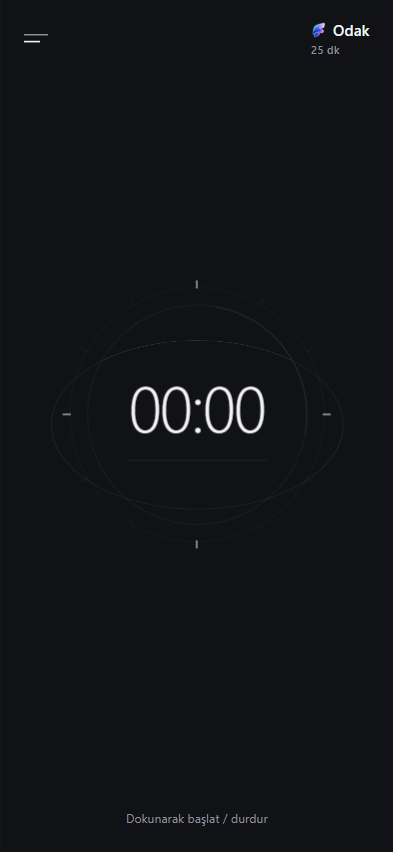
      <p align="left"><sub>Centered chronometer typography on deep obsidian slate (#111215) with subtle kinetic gyro rings and brand mark.</sub></p>
    </td>
    <td align="center" width="25%">
      <b>05 // Kinetic Active Focus</b><br/><br/>
      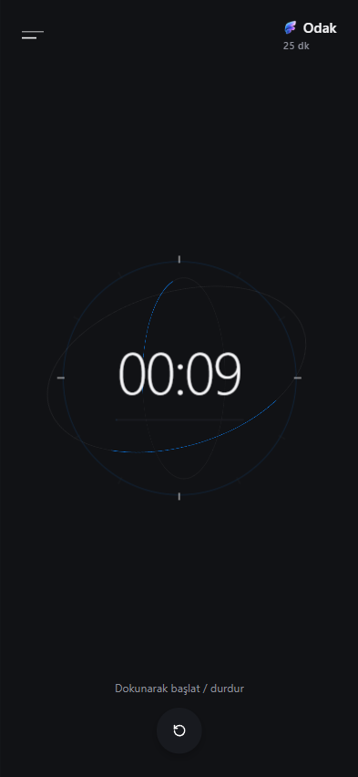
      <p align="left"><sub>High-contrast elapsed countdown with illuminated kinetic trajectory, tick haptics, and responsive reset pill.</sub></p>
    </td>
    <td align="center" width="25%">
      <b>06 // Light Mode Invariance</b><br/><br/>
      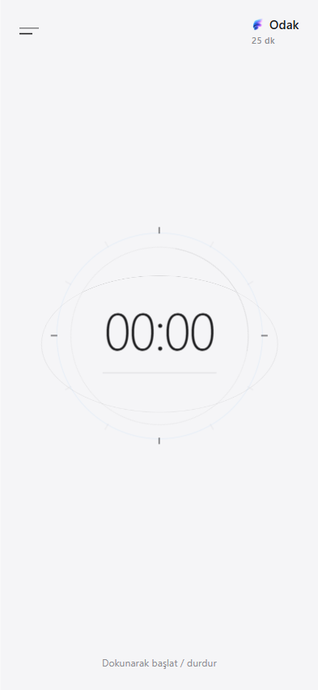
      <p align="left"><sub>Dieter Rams architectural daylight aesthetic with crisp 1px borders, high contrast ratios, and zero glare.</sub></p>
    </td>
    <td align="center" width="25%">
      <b>07 // Pomodoro Cadence</b><br/><br/>
      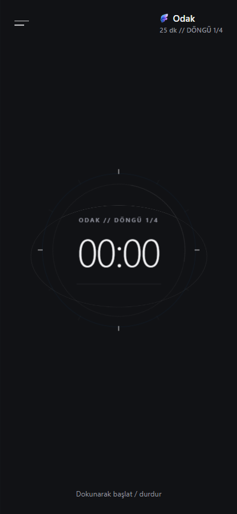
      <p align="left"><sub>Automated state machine tracking focus cycles (e.g. 1/4), short intervals, and long breaks with dedicated telemetry.</sub></p>
    </td>
  </tr>
</table>

#### 3. Architectural Settings Drawer & Controls

<table>
  <tr>
    <td align="center" width="25%">
      <b>08 // 01 Odak (Telemetry)</b><br/><br/>
      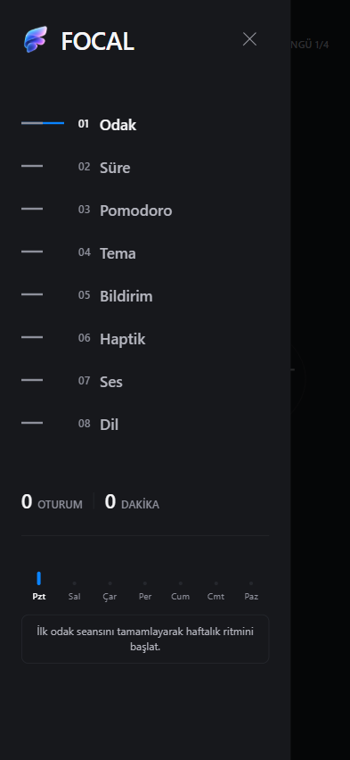
      <p align="left"><sub>Weekly bar telemetry showing completed sessions and focused minutes with timezone-safe Monday rollover.</sub></p>
    </td>
    <td align="center" width="25%">
      <b>09 // 02 Süre (Duration)</b><br/><br/>
      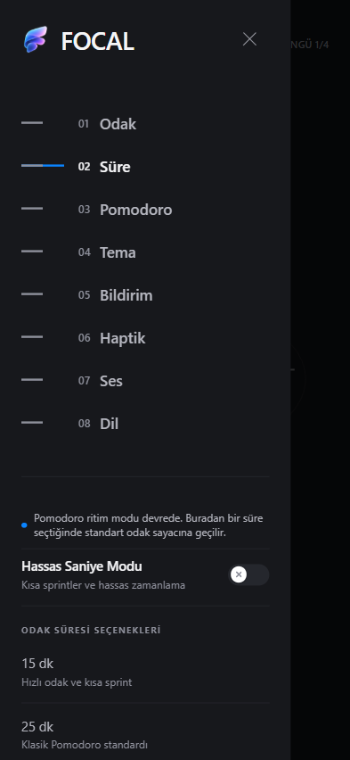
      <p align="left"><sub>Apple Clean List layout with presets (15, 25, 45, 60 dk) and precision second mode for rapid sprint intervals.</sub></p>
    </td>
    <td align="center" width="25%">
      <b>10 // 03 Pomodoro (Engine)</b><br/><br/>
      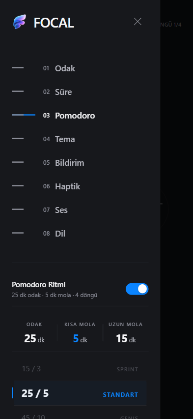
      <p align="left"><sub>Cadence configuration with cycle metrics, quick presets (Sprint, Standard, Extended), and custom interval durations.</sub></p>
    </td>
    <td align="center" width="25%">
      <b>11 // 04 Tema (Contrast)</b><br/><br/>
      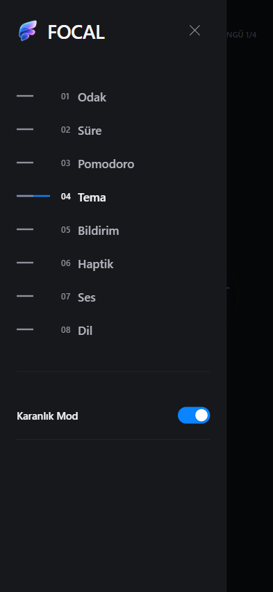
      <p align="left"><sub>Instant dark/light theme switching with custom SVG spring toggle and persistent storage synchronization.</sub></p>
    </td>
  </tr>
</table>

#### 4. Native Protocols, Acoustic Soundscapes & System Banners

<table>
  <tr>
    <td align="center" width="25%">
      <b>12 // 05 Bildirim (Alerts)</b><br/><br/>
      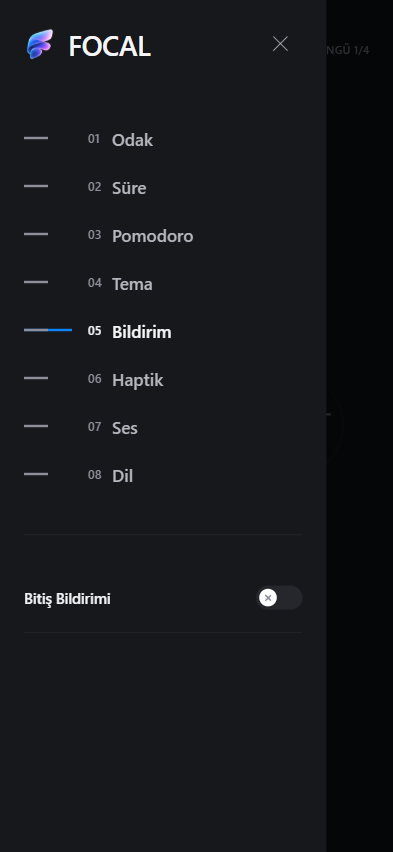
      <p align="left"><sub>Truthful permission architecture with instant state rollback upon OS denial and zero phantom toggles.</sub></p>
    </td>
    <td align="center" width="25%">
      <b>13 // 06 Haptik & Flip</b><br/><br/>
      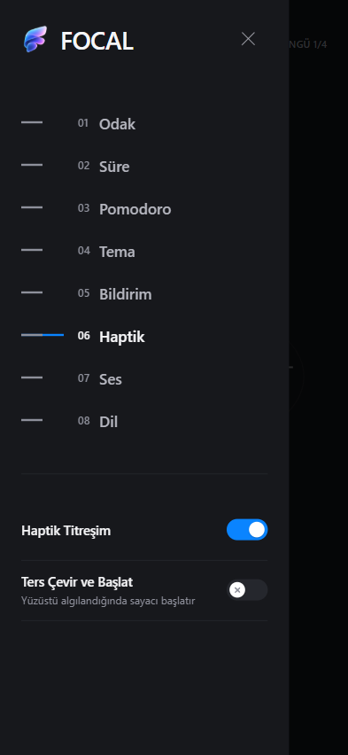
      <p align="left"><sub>Apple Taptic Engine protocols and hardware accelerometer Flip-to-Focus trigger for seamless face-down session start.</sub></p>
    </td>
    <td align="center" width="25%">
      <b>14 // 07 Ses (Soundscapes)</b><br/><br/>
      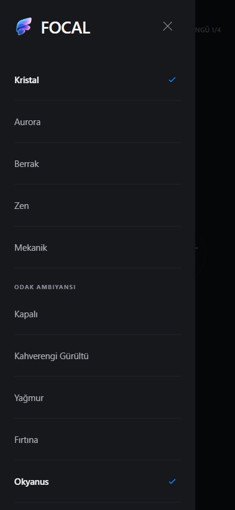
      <p align="left"><sub>Alert tones (Crystal, Aurora, Zen) alongside 5 continuous ambient soundscapes: Brown Noise, Rain, Storm, and Ocean.</sub></p>
    </td>
    <td align="center" width="25%">
      <b>15 // 08 Dil (Locale)</b><br/><br/>
      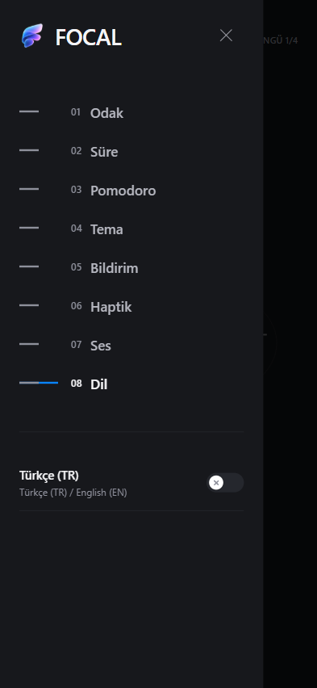
      <p align="left"><sub>Full bi-directional English and Turkish language dictionary applied across the entire layout instantly.</sub></p>
    </td>
  </tr>
  <tr>
    <td align="center" colspan="4">
      <br/>
      <b>16 // Apple OS Notification Banner Architecture</b><br/><br/>
      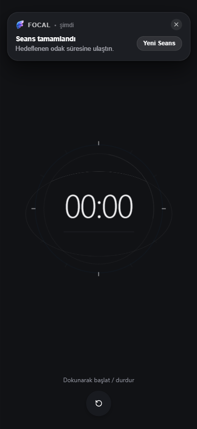<br/>
      <sub>Native floating banner matching Apple HIG metrics: 32px squircle logo, action capsule, pan-to-dismiss gesture, and floating elevation (#1D1F24).</sub>
    </td>
  </tr>
</table>

---

### Key Architectural Pillars

#### 1. 3D Spatial Transitions & Gesture Physics
- Interactive 3D carousel transitions leveraging `react-native-reanimated` worklets executing directly on the native rendering thread.
- Native perspective projection, continuous horizontal inertia, and smooth mathematical rotations without garbage collection overhead or frame drops.

#### 2. Dual Acoustic Sound Engine: Procedural Audio & Master Soundscapes
- **Harmonic Frequency Synthesis:** Local acoustic tone generation for timer ticks, phase starts, and completion chimes across distinct acoustic profiles (Crystal, Aurora, Clarity, Zen, Mechanical, Tibetan).
- **Mastered Ambient Soundscapes:** High-fidelity, continuous soundscapes engineered with equal-power crossfade loops to prevent clicks or repetitive fatigue:
  - Brown Noise: Deep low-pass spectral bed for intense analytical focus.
  - Organic Rain: High-passed multi-transient droplet modeling for cognitive masking.
  - Thunderstorm: Atmospheric distance rumbles and ambient rain curtain.
  - Ocean Surf: Rhythmic tidal surge and shore resonance for calm concentration.
- **Dynamic Crossfade Sync:** Changing soundscapes during an active focus session crossfades smoothly without cutting audio or interrupting the countdown. When idle, a 2.2-second gentle preview plays.

#### 3. Apple Taptic Engine Integration
- Precise tactile communication mapped to timer lifecycle events (start, interval ticks, reset, pause, and step selection).
- Multi-tier feedback patterns using Light, Medium, and Notification haptics.

#### 4. Hardware Flip-to-Focus Gyroscope Integration
- Native device accelerometer monitoring via Expo Sensors (`useFlipToFocus`).
- Turning the device screen face-down automatically starts the focus session with a distinct tactile confirmation. Picking the phone back up pauses the countdown, eliminating touch distraction during deep work.

#### 5. Apple HealthKit Mindful Minutes Integration
- Native health telemetry service (`healthKitService.ts`) providing immediate integration with Apple Health.
- Completed focus and meditation sessions automatically register as Mindful Minutes with verified start and end timestamps.

#### 6. Custom Native SVG Toggle & Reset Architecture
- Engineered `ModernSwitch` component utilizing custom SVG crosshairs and checkmark paths.
- Spring-driven physical travel mechanics with dual-state interpolation for OLED dark and high-contrast light environments.
- Responsive `ModernResetButton` with directional counter-clockwise rotation and smooth spring entrance/exit animations.

#### 7. Apple OS Notification System & Surface Hierarchy
- Authentic iOS notification banner (`AppleNotificationBanner`) matching Apple HIG metrics: 32px squircle icon with official transparent Focal logo, responsive action pill, pan-to-dismiss gesture, and high-contrast Light/Dark surfaces.
- Scheduled local background notifications via Expo Notifications with zero cloud latency.

#### 8. Dark Mode Surface Hierarchy & Tonal Elevation
- Lifted base surface from pure black (`#000000`) to deep obsidian slate (`#111215`), allowing physical drop shadows to naturally render and avoiding the "detached grey box" artifact.
- Restrained tonal elevation ladder: Base (`#111215`) -> Panel Drawer (`#17181C`) -> Floating System Banner (`#1D1F24`).
- Ultra-thin 1px ambient rim highlight (`rgba(255, 255, 255, 0.09)`) catching specular light without harsh artificial outlines.
- Complete Light Mode invariance preserving original high-contrast daytime fidelity.

#### 9. 60–120 FPS Performance & Motion Architecture
- Full render cascade isolation isolating timer ticks from menus and heavy UI surfaces via `React.memo` and stable callback hooks.
- Static allocation hoisting for 3D gyro coordinates and chronometer ticks.
- Dynamic spring physics tuning: gentle entrance, snappy interruptible dismissal.
- Worklet offloading executing gestures and perspective calculations directly on the native UI thread.

#### 10. Apple Settings Clean List & Cadence Panel
- **Dieter Rams Minimalism:** High-contrast surfaces, razor-sharp 1px borders, and clear typographic spacing replacing heavy bubble cards.
- **Apple Settings Clean List:** Native layout with unified unit abbreviations (`15 dk`, `25 dk`, `45 dk`, `60 dk`) and fixed-dimension non-collapsing custom duration inputs.
- **Complete Pomodoro State Machine:** Automated progression between Focus, Short Break, and Long Break intervals, customizable interval durations, cycle coherence, and transparent rhythm mode guidance.

#### 11. App Store Compliance & Native Permission Truthfulness
- **Truthful Permission Flow:** Notification toggle only activates upon confirmed OS `granted === true`; denied or cancelled states immediately revert UI toggles and persist to storage.
- **Guideline 2.5.4 Compliance:** Strictly avoids background audio entitlement (`UIBackgroundModes: ["audio"]`) ensuring immediate App Store review pass for focus timer tools.
- **StatusBar Visibility:** Status bar remains contextually visible with adaptive light/dark typography aligned with Apple Human Interface Guidelines.

#### 12. Root Error Boundary & Production Recovery
- **Dieter Rams System Recovery:** Production crash boundary with offline AsyncStorage error telemetry (`focal.last-error`).
- **Clean Subtree Remount:** Reset trigger leverages `Updates.reloadAsync()` in production and key-based clean unmount/remount in development, preventing infinite crash loops.

#### 13. Timezone-Safe Weekly Telemetry Rollover
- **Calendar-Accurate Rollover:** Pure local date mathematics (`src/utils/date.ts`) bypassing UTC boundary shifts (safe for UTC+3 and international users).
- **DST Compensation:** Normalizes hours to `00:00:00.000` to prevent day skips across daylight saving transitions.

---

### Project Structure

```
focal/
├── assets/
│   ├── focal-logo.png              # High-resolution transparent official brand mark
│   ├── icon.png                    # Square 1024x1024 app store icon on #111215 obsidian
│   ├── android-icon-foreground.png # Android adaptive icon foreground
│   ├── favicon.png                 # Web favicon
│   ├── sounds/                     # Master audio soundscapes & acoustic tonalities
│   └── screenshots/                # High-resolution Retina application flow captures (01-16)
├── src/
│   ├── audio/
│   │   └── soundEngine.ts          # Multi-player acoustic sound engine & web synthesizer
│   ├── components/
│   │   ├── common/
│   │   │   └── RootErrorBoundary.tsx # Dieter Rams high-contrast error boundary
│   │   ├── onboarding/             # 3D Gyro onboarding carousel & slides
│   │   ├── timer/
│   │   │   └── TimerDisplay.tsx    # Isolated chronometer presentation component
│   │   ├── ui/
│   │   │   ├── AppleNotificationBanner.tsx # Native iOS-style banner notification
│   │   │   ├── ModernResetButton.tsx       # Fluid interactive reset trigger
│   │   │   ├── ModernSwitch.tsx            # Custom animated SVG toggle
│   │   │   └── RhythmOptionWheel.tsx       # Apple aperture precision rhythm wheel
│   │   ├── FocusDrawer.tsx         # Slide-over Apple Settings Clean List drawer
│   │   ├── LineSidebar.tsx         # Left-edge vertical navigation indicator
│   │   └── MainFocus3D.tsx         # Kinetic core chronometer
│   ├── hooks/
│   │   ├── useFlipToFocus.ts       # Accelerometer screen-down gesture trigger
│   │   ├── useFocusTimer.ts        # Core focus timer & Pomodoro state machine
│   │   └── usePreferences.ts       # Localized settings and persistent storage sync
│   ├── i18n/
│   │   └── translations.ts         # Bi-lingual English / Turkish translation dictionary
│   ├── notifications/              # Multi-platform notification scheduler (native & web)
│   ├── services/
│   │   ├── healthKitService.ts     # Apple Health Mindful Minutes synchronization
│   │   └── storeReview.ts          # Apple In-App Review request heuristics
│   ├── storage/                    # AsyncStorage + in-memory persistence drivers
│   ├── theme/
│   │   └── colors.ts               # Apple dark mode surface hierarchy tokens
│   └── utils/
│       └── date.ts                 # Local timezone & weekly Monday calculation utilities
├── eas.json                        # EAS build & channel configuration
├── App.tsx                         # Root application entry & coordinator
├── package.json
└── tsconfig.json
```

---

### Getting Started

#### Prerequisites
- Node.js (v18.0 or newer)
- npm or bun
- Expo Go application on iOS/Android or a configured mobile emulator

#### Installation
```bash
git clone https://github.com/sandrotonal/focus-engine.git
cd focus-engine
npm install
```

#### Development Server
```bash
# Start standard Expo Metro bundler
npx expo start

# Run targeting specific platforms
npx expo start --ios
npx expo start --android
npx expo start --web
```

#### Quality Assurance
```bash
# Static typecheck
npx tsc --noEmit

# Code analysis and linting
npx expo lint

# Automated test suite
npm test
```

---

### License
Distributed under the MIT License. Designed and developed with focus-driven precision.
